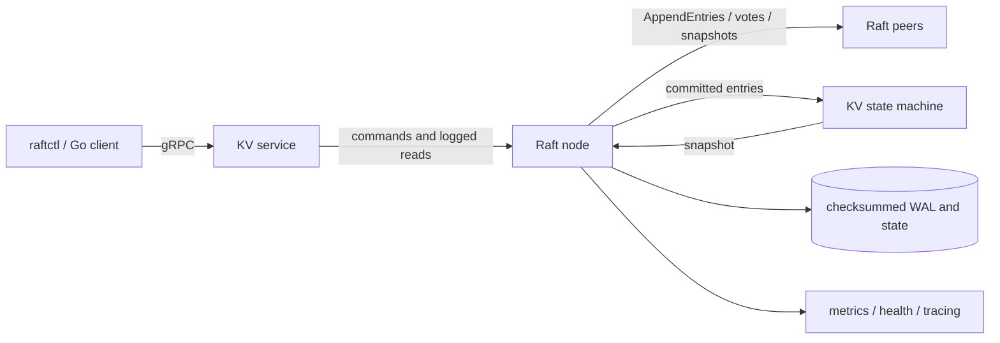

# RaftKV

RaftKV is a work-in-progress replicated configuration store with a Raft
implementation written in this repository. **It is not production-ready:**
the baseline build, race tests, vet and lint pass, but important storage,
security and membership limitations remain. See [ROADMAP.md](ROADMAP.md) for
priorities and estimates, [RAFT_REVIEW.md](RAFT_REVIEW.md) for known deviations,
and [BENCHMARKS.md](BENCHMARKS.md) for measurement status.

| Status | Evidence |
| --- | --- |
| Implemented and baseline-tested | Fixed-membership Raft, KV, gRPC/client, snapshots, Watch and observability. The race suite includes simulated faults, Porcupine histories, gRPC integration, a leader-process kill and a three-second chaos smoke test. A ten-minute five-node chaos run also passed for one seed before the later queued-proposal cancellation fix. |
| Partially implemented | `ReadLatest` is an opt-in ReadIndex API; `Get` still logs reads. Membership listing is fixed-set only; add/remove and learners are absent. Watch cannot list a prefix for full re-read. |
| Verified | `scripts/check.sh` and an uncached `go test -race -count=1 -timeout=2m ./...` passed on macOS/arm64 with Go 1.24.10 and a project-local SDK. Shell syntax, YAML, dashboard JSON and targeted repository hygiene checks also passed. |
| Unverified or incomplete | Production readiness, power-loss durability, multi-seed extended fault testing, the benchmark matrix, Docker and OTLP export. The 3-node/128-client fsync-on write benchmark timed out with repeated term changes; see `BENCHMARKS.md`. Passing tests are not a proof of consensus safety. |



## Intended guarantees and limits

* Committed writes and logged Get operations are intended to be linearizable;
  CompareAndSwap compares the key's version. Versions survive deletion.
* Client ID and sequence deduplicate requests, including read results. A timeout
  is ambiguous: retry the same identity and arguments, not a new write ID.
* `ReadLatest` uses a quorum ReadIndex and does not log a read or preserve a
  retry's original result. It can return not-ready after an election until the
  leader commits a current-term entry.
* Watch uses an exclusive Raft-index cursor and bounded history; a compacted
  cursor requires a full re-read. There is currently no prefix-list API.
* Membership is fixed at startup. `member list` is read-only; dynamic add,
  remove, and learners are not implemented. Never change peer lists piecemeal.
* gRPC is plaintext and unauthenticated; use only on a trusted local network.
  Snapshot transfer is single-message and size-limited. Deduplication history
  can grow without bound. Known storage and Figure 2 risks are in the review.

## Local setup and cluster

Use Go 1.24.10 and the project's pinned tools and caches; do not install tools
globally. All temporary files, downloaded modules and toolchains must remain in
this repository. Generated protobuf bindings and `go.sum` are tracked. With a
network-accessible module proxy and a project-local Go in `PATH`:

```sh
go mod download all
go tool buf generate
go mod tidy
scripts/check.sh
scripts/local-cluster.sh
```

The verification environment used `PATH="$PWD/.toolchain/go/bin:$PATH"` and
`SDKROOT="$PWD/.toolchain/MacOSX.sdk"`; the SDK was copied from the installed
read-only macOS Command Line Tools into this repository. The supplied `HOME`,
`TMPDIR`, Go caches and two-worker `GOFLAGS` were left unchanged.

The cluster script runs three processes on 127.0.0.1 ports 21800–21808, keeps
data in a temporary project-local directory, and removes it on exit. In a
second terminal, after generating bindings:

```sh
go run ./cmd/raftctl put app/key value
go run ./cmd/raftctl get app/key
go run ./cmd/raftctl cas app/key 1 replacement
go run ./cmd/raftctl member list
go run ./cmd/raftctl -after-revision 0 watch app/
```

`raftctl -endpoints ... -timeout ...` sets client endpoints and deadline.
Global flags precede the command. For a repeatable operation identity use both
`-client-id` and `-sequence`; callers must persist and coordinate the sequence.
Metrics and health are served on 21806–21808. `/readyz` is leader-only and
requires a current-term committed entry and a quorum-confirmed applied read.

## Verification and observability

`scripts/check.sh` generates protobuf bindings, builds, runs tests with the race
detector, vets, and runs the pinned linter. The test suite includes a seeded
in-memory network with partitions/loss/reordering, Porcupine histories, real
gRPC process tests, snapshots and restart tests. The process chaos harness is:

```sh
go run ./cmd/chaos -duration=10m -seed=20261107
```

On 2026-11-08, seed `20261107` completed in 10m4.138s with 2,025 operations,
373 injected faults and a Porcupine `Ok` verdict. This was before the later
queued-proposal cancellation fix; the final code passed the short chaos smoke
test but has not repeated that ten-minute run. One run is not a proof.
Further fault testing is tracked in [ROADMAP.md](ROADMAP.md). The optional Compose configurations and
Grafana dashboard are documented in [DESIGN.md](DESIGN.md); Docker-dependent
checks were not run because access to the host daemon is prohibited.

The benchmark-only `-benchmark-no-fsync` flag disables durability and can lose
acknowledged writes. It must never be used for real data.

## License

[MIT](LICENSE), copyright 2026 Mykyta Kizilov.
